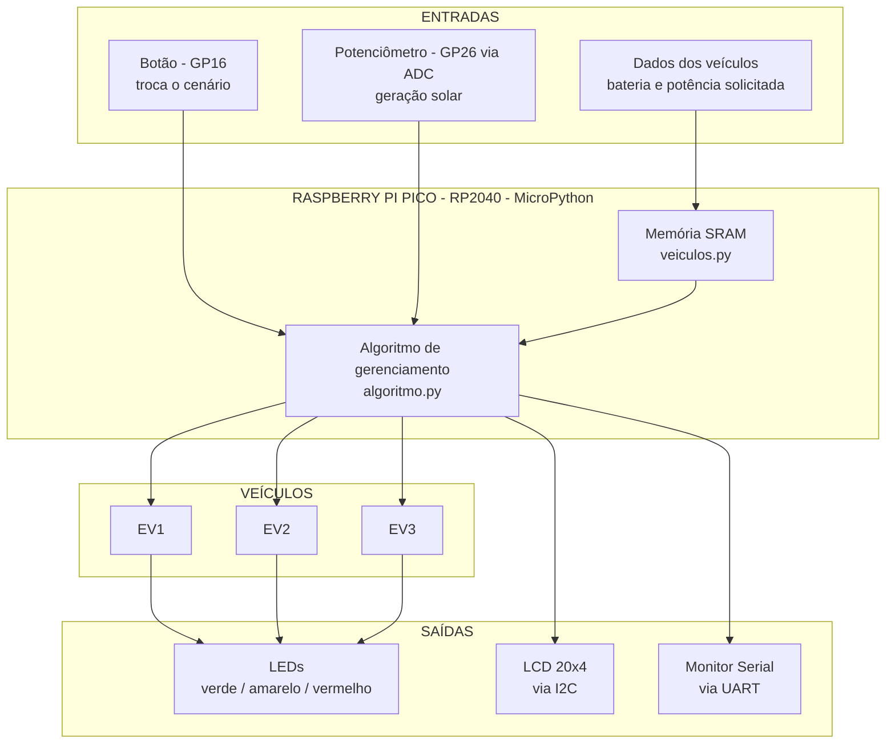
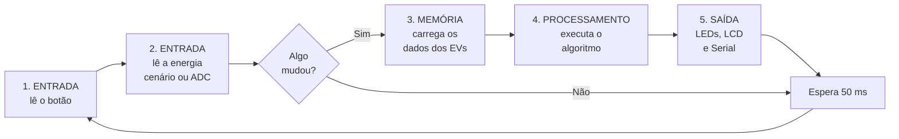
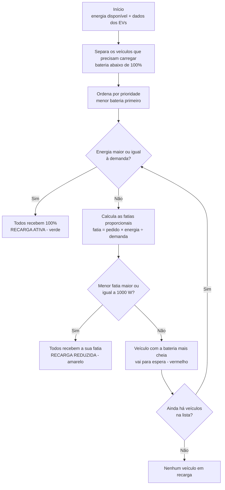

# ⚡ GoodWe Smart Charging Station

**Estação inteligente de recarga de veículos elétricos** simulada no Wokwi com **Raspberry Pi Pico** e **MicroPython**, desenvolvida para a **Sprint 4 da disciplina de Arquitetura de Computadores (FIAP × GoodWe)**.

O sistema recebe a energia disponível, compara com a demanda de **3 veículos elétricos conectados ao mesmo tempo** e decide automaticamente quanta potência cada um recebe. O projeto é inspirado no conceito do **GoodWe Smart Energy Controller**.

---

## 📑 Sumário

1. [Integrantes](#-integrantes)
2. [Links](#-links)
3. [Objetivo](#-objetivo)
4. [Componentes e ligações](#-componentes-e-ligações)
5. [Como usar a simulação](#-como-usar-a-simulação)
6. [Arquitetura do sistema](#-arquitetura-do-sistema)
7. [Fluxo de funcionamento](#-fluxo-de-funcionamento)
8. [Dados na memória](#-dados-na-memória)
9. [Algoritmo de gerenciamento de energia](#-algoritmo-de-gerenciamento-de-energia)
10. [Cenários de demonstração](#-cenários-de-demonstração)
11. [Conceitos de Arquitetura de Computadores](#-conceitos-de-arquitetura-de-computadores)
12. [Representação de dados](#-representação-de-dados)
13. [Relação com a GoodWe](#-relação-com-o-goodwe-smart-energy-controller)
14. [Estrutura do repositório](#-estrutura-do-repositório)
15. [Como executar](#-como-executar)
16. [Melhorias futuras](#-melhorias-futuras)

---

## 👥 Integrantes

| Nome | RM |
|---|---|
| Gustavo Bitencourt | RM568885 |
| Daniel Vieira | RM573326 |
| Leonardo Takachi | RM569066 |
| Giovane Salazar | RM570396 |

## 🔗 Links

| | |
|---|---|
| 🧪 **Simulação no Wokwi** | https://wokwi.com/projects/477698108284517377 |
| 🎥 **Vídeo de demonstração** | https://youtu.be/xP5sg682yL8 |
| 💻 **Repositório no GitHub** | https://github.com/GustavoBitencourtLopes/GoodWe-Smart-Charging-Station |

---

## 🎯 Objetivo

Demonstrar como um sistema computacional pode **gerenciar uma quantidade limitada de energia** entre diferentes veículos elétricos. O Raspberry Pi Pico funciona como o controlador da estação:

- **recebe** a energia disponível e os dados de cada veículo;
- **processa** esses dados com um algoritmo próprio;
- **decide** quanta potência cada veículo recebe;
- **mostra** o resultado por meio de LEDs, display LCD e Monitor Serial.

O projeto também relaciona cada parte da solução aos conteúdos de Arquitetura de Computadores: processador, memória, entrada, saída, comunicação e representação de dados.

---

## 🧩 Componentes e ligações

| Componente | Função | Pino do Pico |
|---|---|---|
| Raspberry Pi Pico (RP2040) | Processador central da estação | — |
| Display LCD 20x4 com módulo I2C | Saída: dados da estação | SDA = GP4 · SCL = GP5 |
| LEDs do EV1 (verde, amarelo, vermelho) | Saída: estado da recarga do EV1 | GP6 · GP7 · GP8 |
| LEDs do EV2 (verde, amarelo, vermelho) | Saída: estado da recarga do EV2 | GP9 · GP10 · GP11 |
| LEDs do EV3 (verde, amarelo, vermelho) | Saída: estado da recarga do EV3 | GP12 · GP13 · GP14 |
| 9 resistores de 220 Ω | Limitam a corrente dos LEDs | — |
| Botão azul | Entrada digital: troca o cenário | GP16 (pull-up interno) |
| Potenciômetro | Entrada analógica: simula a geração solar | GP26 (ADC0) |
| LED da placa | Pisca enquanto o sistema está rodando | GP25 |
| Monitor Serial | Saída: relatório completo | GP0 / GP1 (UART) |

---

## 🎮 Como usar a simulação

**Botão azul:** troca o modo de operação a cada clique.

```
CEN 1 (8000 W)  →  CEN 2 (5000 W)  →  CEN 3 (2000 W)  →  SOLAR (potenciômetro)  →  CEN 1 ...
```

**Potenciômetro (modo SOLAR):** define a energia gerada entre **0 e 9.000 W**, simulando a geração solar variando ao longo do dia.

**Display LCD:** alterna a cada 4 segundos entre duas páginas.

| Página 1: veículos | Página 2: dados |
|---|---|
| `CEN 2 5000W/7500W` | `RECARGA CONTROLADA` |
| `EV1  20% 1333W REDUZ` | `DEC 5000 W` |
| `EV2  50% 1666W REDUZ` | `HEX 0x1388` |
| `EV3  80% 2000W REDUZ` | `BIN 1001110001000` |

**Monitor Serial:** a cada mudança, mostra a tabela completa dos veículos, as **decisões do algoritmo passo a passo** e a representação dos dados em decimal, hexadecimal e binário.

### Significado dos LEDs

| LED | Estado | Significado |
|---|---|---|
| 🟢 Verde | RECARGA ATIVA | O veículo recebe 100% da potência solicitada |
| 🟡 Amarelo | RECARGA REDUZIDA | O veículo recebe menos do que pediu |
| 🔴 Vermelho | AGUARDANDO | O veículo está em espera e não recebe energia |
| ⚫ Apagados | BATERIA CHEIA | O veículo está com 100% e não precisa carregar |

### Status geral da estação

| Status | Quando acontece |
|---|---|
| **RECARGA ATIVA** | Todos os veículos recebem 100% |
| **RECARGA CONTROLADA** | Algum veículo recebe potência reduzida, mas ninguém está em espera |
| **RECARGA LIMITADA** | Pelo menos um veículo está em espera |
| **ESTAÇÃO OCIOSA** | Nenhum veículo precisa carregar |

---

## 🧱 Arquitetura do sistema



<details>
<summary><b>Versão em texto (formato do enunciado)</b></summary>

```
              ENTRADAS
                  │
     ┌────────────────────────────┐
     │ Energia disponível         │  ← botão (cenários) ou potenciômetro (ADC)
     │ Bateria dos EVs            │
     │ Potência solicitada        │
     └────────────────────────────┘
                  │
                  ▼
     ┌────────────────────────────┐
     │    RASPBERRY PI PICO       │
     │  RP2040 · ARM Cortex-M0+   │
     │        MicroPython         │
     │                            │
     │  Memória (SRAM): dados     │
     │  dos veículos e da sessão  │
     └────────────────────────────┘
                  │
                  ▼
     ┌────────────────────────────┐
     │  Algoritmo de              │
     │  gerenciamento de energia  │
     └────────────────────────────┘
                  │
          ┌───────┼───────┐
          ▼       ▼       ▼
         EV1     EV2     EV3
          │       │       │
          ▼       ▼       ▼
   LEDs  ·  LCD (I2C)  ·  Monitor Serial (UART)
```

</details>

### Organização do código

O código foi dividido em arquivos seguindo a própria arquitetura do sistema:

| Arquivo | Papel na arquitetura | Responsabilidade |
|---|---|---|
| `main.py` | **Controle** | Ciclo principal: lê as entradas, chama o processamento e atualiza as saídas |
| `veiculos.py` | **Memória** | Dados dos veículos e codificação dos estados |
| `algoritmo.py` | **Processamento** | Decide quanta energia cada veículo recebe |
| `interface.py` | **Saída** | Controla LEDs, LCD e Monitor Serial |
| `representacao.py` | **Representação de dados** | Mostra os dados em decimal, hexadecimal e binário, além de informações do processador e da memória |
| `lcd_i2c.py` | **Comunicação** | Driver do LCD pelo barramento I2C |
| `diagram.json` | **Hardware** | Circuito da simulação no Wokwi |

---

## 🔄 Fluxo de funcionamento

O `main.py` repete o mesmo ciclo o tempo todo, a cada 50 ms:



### Perguntas do enunciado

**Quais dados entram?**
A **energia disponível** (definida pelo botão de cenários ou lida do potenciômetro pelo ADC), o **nível da bateria** e a **potência solicitada** por cada veículo.

**Como o Raspberry Pi Pico processa esses dados?**
O processador RP2040 executa o programa em MicroPython. A cada ciclo, ele lê as entradas e, se algo mudou, executa o algoritmo de gerenciamento: compara a energia disponível com a demanda total, calcula a fatia de cada veículo e define o estado de cada recarga. Todas as contas usam aritmética inteira.

**Onde os dados são armazenados durante a execução?**
Na **memória RAM (SRAM)** do Pico, que tem 264 KB. Os dados ficam numa lista de dicionários, com um dicionário por veículo (veja [Dados na memória](#-dados-na-memória)). O programa em si fica gravado na **memória Flash** (2 MB), que não se apaga ao desligar.

**Como o sistema toma a decisão?**
Pelo algoritmo de divisão proporcional com prioridade por bateria, explicado em [Algoritmo de gerenciamento de energia](#-algoritmo-de-gerenciamento-de-energia).

**Quais informações são apresentadas como saída?**
- **LEDs:** o estado de cada veículo (verde, amarelo ou vermelho).
- **LCD:** o modo, a energia disponível e a demanda, a bateria, a potência e o estado de cada veículo, o status da estação e a energia em DEC/HEX/BIN.
- **Monitor Serial:** a tabela completa, as decisões do algoritmo, a representação dos dados, a frequência do processador e a memória livre.

---

## 💾 Dados na memória

Cada veículo é representado por um dicionário e os três ficam numa lista na SRAM:

```python
veiculos = [
    {"id": "EV1", "bateria": 20, "solicitada": 2000, "recebida": 1333, "estado": 1},
    {"id": "EV2", "bateria": 50, "solicitada": 2500, "recebida": 1666, "estado": 1},
    {"id": "EV3", "bateria": 80, "solicitada": 3000, "recebida": 2000, "estado": 1},
]
```

| Campo | Tipo | Significado |
|---|---|---|
| `id` | texto | Identificação do veículo |
| `bateria` | inteiro | Nível da bateria (%) |
| `solicitada` | inteiro | Potência pedida pelo veículo (W) |
| `recebida` | inteiro | Potência liberada pelo controlador (W) |
| `estado` | inteiro (2 bits) | Estado da recarga |

### Codificação dos estados

Os estados são guardados como **números inteiros**. Como são 4 estados, bastam **2 bits** para representar todos:

| Estado | Decimal | Binário | LED |
|---|---|---|---|
| RECARGA ATIVA | 0 | `00` | 🟢 |
| RECARGA REDUZIDA | 1 | `01` | 🟡 |
| AGUARDANDO | 2 | `10` | 🔴 |
| BATERIA CHEIA | 3 | `11` | ⚫ |

O texto ("RECARGA ATIVA" etc.) só aparece na hora de mostrar para o usuário: o número do estado é usado como **índice** numa lista de nomes.

---

## 🧠 Algoritmo de gerenciamento de energia

### Estratégia: divisão proporcional com prioridade por nível de bateria

1. **Energia suficiente:** se a energia disponível cobre a demanda total, todos recebem 100% do que pediram (🟢).
2. **Energia insuficiente:** a energia é dividida **proporcionalmente** ao pedido de cada veículo. Quem pediu mais recebe mais, mas todos recebem menos que o pedido (🟡).
3. **Fatia pequena demais:** se alguma fatia ficar abaixo da **potência mínima de 1.000 W**, o veículo com a **bateria mais cheia** (o menos urgente) vai para espera (🔴) e a divisão é refeita entre os restantes. Isso se repete até encontrar uma distribuição válida.



### Pseudocódigo

```
candidatos ← veículos com bateria < 100%, ordenados da menor para a maior bateria

enquanto houver candidatos:
    demanda ← soma das potências solicitadas pelos candidatos
    se energia ≥ demanda:
        todos recebem 100%                        → ATIVA
        parar
    fatias ← pedido × energia // demanda          (divisão inteira)
    se menor fatia ≥ 1000 W:
        todos recebem a sua fatia                 → REDUZIDA
        parar
    remover o último candidato (maior bateria)    → ESPERA
```

### Justificativas técnicas

| Decisão | Motivo |
|---|---|
| **Divisão proporcional** | É justa: cada veículo perde a mesma porcentagem do que pediu |
| **Potência mínima de 1.000 W** | Carregadores reais não operam abaixo de uma corrente mínima. Liberar pouca energia para muitos carros desperdiçaria energia que poderia carregar outro de verdade |
| **Prioridade para a menor bateria** | O veículo com a bateria mais baixa tem o maior risco de ficar sem carga |
| **Somente números inteiros** | O processador do Pico (ARM Cortex-M0+) **não possui FPU** (unidade de ponto flutuante), então contas com inteiros são mais rápidas |
| **Divisão inteira (`//`)** | Arredonda sempre para baixo, garantindo que o total liberado **nunca ultrapasse** a energia disponível. Num sistema elétrico real, passar do limite pode desarmar a proteção |
| **Registro das decisões** | Cada decisão é impressa no Monitor Serial, deixando o comportamento do algoritmo transparente |

---

## 🚦 Cenários de demonstração

**Veículos:** EV1 (bateria 20%, pede 2.000 W) · EV2 (50%, pede 2.500 W) · EV3 (80%, pede 3.000 W)
**Demanda total:** 7.500 W

### Os 3 cenários obrigatórios

| Cenário | Energia | EV1 | EV2 | EV3 | Total liberado | Status |
|---|---|---|---|---|---|---|
| 1 – Alta disponibilidade ☀️ | 8.000 W | 🟢 2.000 W | 🟢 2.500 W | 🟢 3.000 W | 7.500 W | RECARGA ATIVA |
| 2 – Disponibilidade limitada ⛅ | 5.000 W | 🟡 1.333 W | 🟡 1.666 W | 🟡 2.000 W | 4.999 W | RECARGA CONTROLADA |
| 3 – Baixa disponibilidade 🌧️ | 2.000 W | 🟢 2.000 W | 🔴 0 W | 🔴 0 W | 2.000 W | RECARGA LIMITADA |

### Decisões do algoritmo em cada cenário (saída real do Monitor Serial)

**Cenário 1**
```
-> Energia 8000 W >= demanda 7500 W: todos recebem 100%
```

**Cenário 2**
```
-> Energia 5000 W < demanda 7500 W: cada um recebe 66% do pedido
```

**Cenário 3**
```
-> Dividindo 2000 W, a menor fatia seria 533 W (< 1000 W). EV3 (80%) vai para espera
-> Dividindo 2000 W, a menor fatia seria 888 W (< 1000 W). EV2 (50%) vai para espera
-> Energia 2000 W >= demanda 2000 W: todos recebem 100%
```

### Casos extras (modo SOLAR)

| Energia | EV1 | EV2 | EV3 | Status | O que acontece |
|---|---|---|---|---|---|
| 3.500 W | 🟡 1.555 W | 🟡 1.944 W | 🔴 0 W | RECARGA LIMITADA | O EV3 espera e os outros dois dividem a energia |
| 800 W | 🔴 0 W | 🔴 0 W | 🔴 0 W | RECARGA LIMITADA | Nenhuma fatia atinge o mínimo, então todos esperam |

---

## 💻 Conceitos de Arquitetura de Computadores

| Conceito | Aplicação no projeto |
|---|---|
| **Processador** | Raspberry Pi Pico com o microcontrolador **RP2040**: dual-core ARM Cortex-M0+, operando a 125 MHz (frequência exibida no Serial) |
| **Memória** | **SRAM** (264 KB, volátil): dados dos veículos e da sessão durante a execução. **Flash** (2 MB, não volátil): o programa. A memória livre é exibida no Serial |
| **Representação de dados** | Energia, bateria e potência guardadas como números inteiros; estados codificados em **2 bits** |
| **Sistemas numéricos** | Energia, bateria, endereço I2C e leitura do ADC exibidos em **decimal, hexadecimal e binário** |
| **Entrada** | Botão (sinal **digital**: 0 ou 1, com resistor de pull-up interno) e potenciômetro (sinal **analógico** convertido pelo **ADC**) |
| **Processamento** | Algoritmo de divisão proporcional com prioridade, usando apenas aritmética inteira |
| **Saída** | 9 LEDs, display LCD 20x4 e Monitor Serial |
| **Comunicação** | **I2C** com o LCD (2 fios: SDA = dados, SCL = clock; endereço `0x27`) e **UART** (serial) com o Monitor |
| **Automação** | A decisão sobre cada recarga é tomada automaticamente, sem intervenção humana, e reage em tempo real à variação de energia |

---

## 🔢 Representação de dados

### Exemplo principal

```
Energia disponível: 5000 W

Decimal:      5000
Hexadecimal:  0x1388
Binário:      1001110001000   (13 bits)
```

**Conferindo a conversão para hexadecimal:**
`0x1388 = 1×16³ + 3×16² + 8×16¹ + 8×16⁰ = 4096 + 768 + 128 + 8 = 5000`

### Outros dados do sistema

| Dado | Decimal | Hexadecimal | Binário |
|---|---|---|---|
| Energia do cenário 1 | 8000 | `0x1F40` | `1111101000000` |
| Energia do cenário 2 | 5000 | `0x1388` | `1001110001000` |
| Energia do cenário 3 | 2000 | `0x07D0` | `11111010000` |
| Bateria do EV1 | 20 | `0x14` | `10100` |
| Endereço I2C do LCD | 39 | `0x27` | `100111` |
| Estado "RECARGA REDUZIDA" | 1 | `0x1` | `01` |
| Leitura máxima do ADC | 65535 | `0xFFFF` | `1111111111111111` (16 bits) |

### O ADC (conversor analógico-digital)

O potenciômetro gera uma **tensão** (sinal analógico). O ADC do RP2040 converte essa tensão em um número binário com resolução de **12 bits**, e o MicroPython escala o resultado para **16 bits** (`read_u16()`, de 0 a 65535). O sistema converte esse número em watts:

```
energia = (leitura × 90 // 65535) × 100      → de 0 a 9000 W, em passos de 100 W
```

No modo SOLAR, a leitura do ADC também é exibida no Serial em decimal, hexadecimal e binário de 16 bits.

---

## 🔋 Relação com o GoodWe Smart Energy Controller

O **GoodWe Smart Energy Controller** monitora a energia disponível no sistema (geração solar, rede e baterias) e distribui essa energia entre as cargas de forma automática, evitando sobrecarga e aproveitando melhor a geração.

Este projeto é uma **versão educacional** desse conceito:

| GoodWe Smart Energy Controller | Este projeto |
|---|---|
| Mede a geração solar em tempo real | O potenciômetro simula a geração, lida pelo ADC |
| Controlador que decide a distribuição | O Raspberry Pi Pico com o algoritmo |
| Balanceamento de carga entre equipamentos | Divisão proporcional entre os carregadores |
| Evita ultrapassar a capacidade da instalação | Divisão inteira garante que o total nunca passa do limite |
| Prioriza cargas mais importantes | Prioriza o veículo com a bateria mais baixa |

> A proposta não reproduz todos os recursos de um produto comercial. O objetivo é demonstrar, de forma educacional, como algoritmos e automação contribuem para o uso eficiente da energia disponível.

---

## 📁 Estrutura do repositório

```
GoodWe-Smart-Charging-Station/
├── main.py             # Ciclo principal: entrada → processamento → saída
├── veiculos.py         # Memória: dados dos veículos e estados
├── algoritmo.py        # Processamento: distribuição de energia
├── interface.py        # Saídas: LEDs, LCD e Monitor Serial
├── representacao.py    # Decimal, hexadecimal, binário e informações do sistema
├── lcd_i2c.py          # Driver do LCD via I2C
├── diagram.json        # Circuito da simulação no Wokwi
└── README.md           # Esta documentação
```

---

## 🚀 Como executar

### Pelo link (mais fácil)
1. Abra o link do Wokwi na seção [Links](#-links).
2. Clique em ▶ para iniciar a simulação.
3. Use o botão azul para trocar os cenários e o potenciômetro no modo SOLAR.

### Montando do zero
1. Crie um projeto em **wokwi.com** com **Raspberry Pi Pico + MicroPython**.
2. Anote o valor de `"env"` na linha do Pico do `diagram.json` criado pelo Wokwi.
3. Substitua o `diagram.json` pelo deste repositório e restaure o valor de `"env"` anotado.
4. Substitua o `main.py` e crie os outros arquivos `.py` com os mesmos nomes deste repositório.
5. Clique em ▶. O LED da placa piscando indica que o sistema está rodando.

---

## 💡 Melhorias futuras

- Simular o carregamento das baterias ao longo do tempo, com a prioridade sendo recalculada automaticamente.
- Permitir que o usuário escolha a prioridade (por bateria, por ordem de chegada ou por tarifa).
- Usar o **Raspberry Pi Pico W** para enviar os dados por Wi-Fi a um painel web em tempo real.
- Considerar tarifas por horário, priorizando a recarga quando a energia é mais barata ou a geração solar é maior.

---

<p align="center">
Desenvolvido para a disciplina de <b>Arquitetura de Computadores</b> · <b>FIAP</b> × <b>GoodWe</b>
</p>
